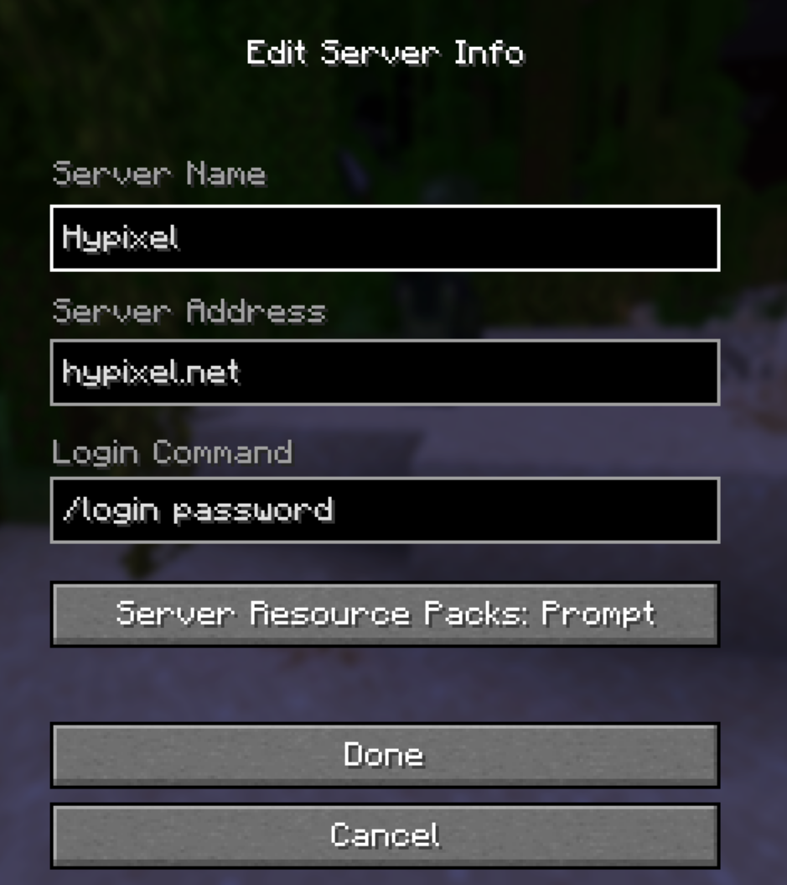

# AutoLogin


A Minecraft Fabric mod that automatically executes login commands when joining servers.

## Features

- 🔐 **Automatic Login**: Automatically sends login commands when joining a server
- ⚙️ **Server-Specific Configuration**: Configure different login commands for each server
- 🎯 **Simple Setup**: Easy-to-use interface integrated into Minecraft's server list
- ✅ **Visual Feedback**: In-game confirmation messages when auto-login executes

## Screenshots

### Server Configuration
Configure your login command directly in the server edit screen:



### In-Game
The mod automatically sends your login command upon joining:


## Installation

1. Install [Fabric Loader](https://fabricmc.net/use/)
2. Download [Fabric API](https://modrinth.com/mod/fabric-api) for Minecraft 1.21.11
3. Download the latest AutoLogin release
4. Place the `.jar` file in your `mods` folder

## Usage

1. Go to your Minecraft server list
2. Click "Edit" on the server you want to configure
3. Enter your login command in the "Login Command" field (e.g., `/login password`)
4. Save and join the server
5. The mod will automatically execute the command upon joining

## Building from Source

```bash
git clone https://github.com/davidutzdev/AutoLogin.git
cd AutoLogin
./gradlew build
```

The compiled JAR will be in `build/libs/`.

## Requirements

- Minecraft 1.21.11
- Fabric Loader 0.18.4+
- Fabric API 0.141.3+
- Java 21

## License

This project is licensed under MIT License. See [LICENSE](LICENSE) for more information.

## Author

Created by [DavidutzDev](https://github.com/davidutzdev).
